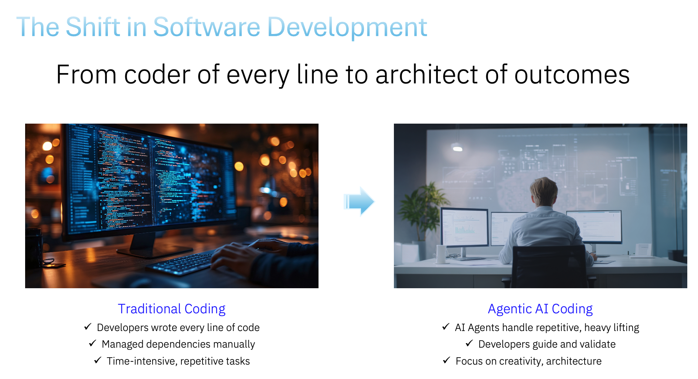
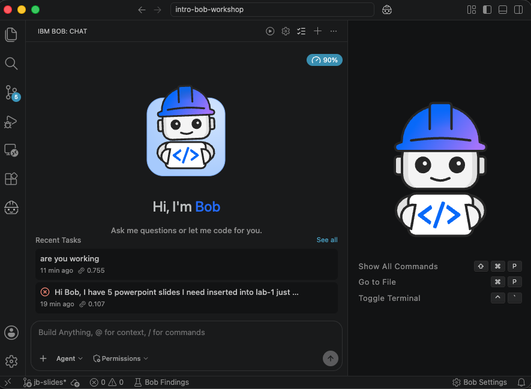

# Bob AI Workshop for High School Students
## Introduction to Agentic AI with IBM Bob

### Workshop Overview
This workshop introduces high school students to agentic AI through hands-on exercises with Bob, an AI assistant that can autonomously use tools to accomplish tasks. Students first learn how the quality of a prompt changes the quality of the result, then use that skill to build a project of their own and present it to the group.

**Duration:** 75 minutes total

- **45 minutes** hands-on workshop
- **30 minutes** student presentations

**Prerequisites:** Basic computer literacy, curiosity about AI

**Materials Needed:** Laptops with Bob access, internet connection

---

## Workshop Agenda

| Time | Activity |
| :--- | :--- |
| 0:00 - 0:05 | Welcome, what is agentic AI?, live demo, and set up your workspace |
| 0:05 - 0:15 | **Part 1:** Prompt Engineering Challenge (3 prompts) |
| 0:15 - 0:40 | **Part 2:** Build Your Own Project |
| 0:40 - 0:45 | **Part 3:** Prepare Your Presentation |
| 0:45 - 1:15 | **Part 4:** Student Presentations |

---

## What is Agentic AI?

**Traditional AI Chatbots:**

- Answer questions
- Provide information
- Have conversations

**Agentic AI (like Bob):**

- Takes autonomous actions
- Uses tools to accomplish tasks
- Breaks down complex problems into steps
- Learns from results and adapts

**The key idea for today:** Bob is only as good as the instructions you give him. Learning to write a clear prompt is the most useful skill you will practice in this workshop.





### Watch Bob Work: Live Demo

Your instructor will give Bob one short prompt on the big screen, such as:

```
Make a page that says hello with a button that changes the background color.
Save it in a folder called demo and then open the page in my default browser.
```

Watch what Bob does along the way:

- **Bob makes a plan:** he breaks the request into steps before he starts
- **Bob asks permission:** you approve each action, so you stay in control
- **Bob creates files:** he writes the code himself instead of just describing it
- **Bob shows the result:** he opens the finished page in the browser

A chatbot would have stopped at step one and handed you instructions. Bob did the work.

---

## Set Up Your Workspace

Bob can only read and create files inside the folder you open. Before Part 1, make a new folder for today's projects and open it in Bob.

**Step 1: Create and open a new folder**

1. In the left sidebar, click the **"Open Folder"** button
2. Navigate to where you want your workshop folder (for example, Desktop or Documents)
3. Click the **"New Folder"** button
4. Name it something like `bob-workshop`
5. Select your new folder and click **"Open"**

**Step 2: Grant permission (trust the folder)**

When Bob opens a folder for the first time, it asks whether you trust the authors of the files in the folder. Since you just created this folder yourself, it is safe.

- Click **"Yes, I trust the authors"** (or **"Trust folder"**, depending on your version)

!!! warning "Do not click Don't trust"
    If you choose "Don't trust", Bob runs in restricted safe mode and some features will not work as expected. If you clicked it by accident, close the folder and open it again to get the prompt back.

**Step 3: Check that it worked**

- The name of your new folder appears at the top of the file Explorer on the left
- Bob's chat panel is open on the side

**Step 4: Approving Bob's actions**

Bob asks for your permission before he creates files or opens your browser. When you see an approval request in the chat, read it and click **"Approve"**. If Bob seems stuck, check the chat for a waiting approval button.

Everything Bob creates today, including the `attempt-1-bad`, `attempt-2-better`, and `attempt-3-good` folders, will be saved inside the folder you just opened.

---

## Part 1: Prompt Engineering Challenge

### Exercise 1.1: Three Prompts, Three Results

**Objective:** See for yourself how a better prompt produces a better result.

**Task:** Ask Bob to build the same thing three times. Each time, you submit a better prompt than the last. Save each result in its own folder so you can compare them side by side in your browser.

!!! note "Pick one topic and stay with it"
    Choose ONE topic you care about (a sport, a game, a hobby, a school subject, a band). Use the same topic for all three prompts. The only thing that changes is how well you describe what you want. The examples below use basketball, so replace "basketball" with your own topic before you paste.

!!! warning "Start a new task for each prompt"
    Bob remembers everything earlier in the same chat. If you send prompt 2 in the same chat as prompt 1, Bob has already seen your first attempt and the comparison is not fair. Click the **+** (New task) icon at the top of the Bob chat before each prompt so every attempt starts from zero.

#### Prompt 1: The Bad Prompt

Write a short, vague prompt, the kind most people type without thinking. Copy and paste this one, or type your own vague version and keep the "Save the result..." sentence at the end. You can also add your topic, like "make a website about basketball":

```
make a website
Save the result in a folder called attempt-1-bad and then open the page
in my default browser.
```

Bob saves the files in `attempt-1-bad` and opens the page for you. Notice what you got.

**Questions to ask yourself:**

- Does it look like what you pictured in your head?
- What did Bob have to guess?

---

#### Prompt 2: The Better Prompt

Start a new task (click **+**), then add the basics: what it is about and what it should contain. Example (replace "basketball" with your topic):

```
Make a website about basketball with a title, a short description,
and a list of my favorite teams. Save the result in a folder called
attempt-2-better and then open the page in my default browser.
```

Bob opens the result for you. Compare it with attempt 1.

**Questions to ask yourself:**

- What got better?
- What is still missing or not what you wanted?

---

#### Prompt 3: The Good Prompt

Start a new task (click **+**), then write a complete prompt using the checklist below. Example (replace "basketball" and "Hoops Hub" with your own topic and name):

```
Create a website for high school basketball fans called "Hoops Hub".

Audience: students at my school who follow basketball.

Features:
- A header with the name and a short tagline
- A section with 5 favorite teams, each shown as a card with a team name,
  city, and one fun fact
- A "Pick Your Winner" button that randomly selects a team and shows it
  in large text
- A footer with the current year

Style: dark blue and orange color scheme, modern and clean, large readable
fonts, and cards that grow slightly when the mouse hovers over them.

Make it work on both a laptop and a phone screen.
Save everything in a folder called attempt-3-good and then open the page
in my default browser.
```

Bob opens the result for you. Compare all three attempts side by side.

---

### The Good Prompt Checklist

| Ingredient | What to include | Example |
| :--- | :--- | :--- |
| **Goal** | What are you making? | "A website for basketball fans" |
| **Audience** | Who is it for? | "Students at my school" |
| **Features** | What should it do or contain? | "A button that picks a random team" |
| **Style** | How should it look and feel? | "Dark blue and orange, modern, clean" |
| **Constraints** | Any rules or limits? | "Works on phone and laptop" |
| **Output** | Where should it be saved? | "In a folder called attempt-3-good" |

---

### Debrief

Discuss as a group:

- What changed between prompt 1, 2, and 3?
- Which ingredient from the checklist made the biggest difference?
- What did Bob have to guess in the bad prompt that you told him in the good one?
- Was the good prompt worth the extra typing?

**Key takeaway:** Bob did not get smarter between attempts. You gave him better information, so he made better choices.

---

## Part 2: Build Your Own Project (25 minutes)

### Exercise 2.1: Your Project, Your Prompt

**Objective:** Apply the good-prompt checklist to build something unique.

**Task:** Choose ONE project idea (or invent your own) and write a good prompt for it from the start. Use all six ingredients from the checklist.

**Project ideas (pick one):**

- **Study Quiz:** Interactive quiz for a subject you are learning
- **Mood Tracker:** Track and visualize your daily mood
- **Decision Maker:** Random decision or advice generator
- **Countdown Timer:** Timer for an important event, like prom or a game
- **Click Game:** A game where objects appear on screen and you score points
- **Virtual Pet:** Interactive pet that reacts to clicks
- **Your own idea:** Any small website or web game you can describe clearly

**Before you prompt:** Click the **+** (New task) icon at the top of the Bob chat so Bob starts fresh and does not mix this project up with your earlier attempts.

**Prompt template:**

```
Create [what it is] for [who it is for].

Features:
- [feature 1]
- [feature 2]
- [feature 3]

Style: [colors, mood, look and feel]

Constraints: [anything it must or must not do]
Save everything in a folder called "[project-name]".
```

**What to observe:**

- Bob creates a complete, working application
- Bob handles multiple files (HTML, CSS, JavaScript)
- You can actually open and use what Bob creates

---

### Exercise 2.2: Iteration Challenge

**Objective:** Improve your project by giving Bob one precise follow-up request.

After Bob builds your project, ask him to add ONE new feature or fix ONE thing you do not like.

!!! warning "Stay in the same task"
    Do not click **+** for this step. Bob needs to remember the project he just built so he can change it.

```
Add [specific feature] to my project.
```

or

```
The [specific element] looks [problem]. Change it so that [what you want].
```

**What to observe:**

- Bob reads the existing code first
- Bob makes targeted changes instead of starting over
- Bob keeps the parts that already work

!!! tip "Specific beats vague"
    "Make it better" gives Bob nothing to work with. "Make the score text larger and turn it red when time is under 10 seconds" gives him exactly what he needs.

### If You Finish Early

1. **Combine Projects:** Ask Bob to combine two of your projects into one
2. **Add Advanced Features:** Request Bob add more complex functionality
3. **Explore Different Styles:** Ask Bob to redesign a project in a completely different visual style
4. **Debug Challenge:** Intentionally break something and ask Bob to fix it
5. **Documentation:** Ask Bob to create detailed documentation for one of your projects

Stuck on how to word a request? See [Tips for Working with Bob](#tips-for-working-with-bob) further down this page.

---

## Part 3: Prepare Your Presentation (5 minutes)

Each student (or team) will give a short presentation. Use this time to get ready.

**Your presentation should cover:**

1. **What you built:** Show it running in your browser.
2. **Your best prompt:** Read or show the prompt that got you the best result.
3. **One lesson learned:** What did you learn about working with Bob?

**Optional extras:**

- Show your attempt 1 (bad) and attempt 3 (good) side by side
- Share one thing Bob got wrong and how you fixed it

---

## Part 4: Student Presentations (30 minutes)

### Format

| Group size | Time per presentation | Breakdown |
| :--- | :--- | :--- |
| Up to 6 presenters | 5 minutes | 3 minutes demo, 2 minutes questions |
| 7 to 10 presenters | 3 minutes | 2 minutes demo, 1 minute questions |
| 11 or more presenters | Work in teams of 2 to 3 | Pick one team presenter, keep 3 minutes each |

### Presentation Guide

**While presenting:**

- Open your project in the browser and show it working
- Read your best prompt out loud
- Explain one thing that surprised you

**While watching:**

- Notice which prompts led to the strongest results
- Think of one question to ask the presenter
- Listen for ideas you could borrow

### Wrap-Up Discussion (last 3 to 5 minutes)

- What was the coolest thing Bob created today?
- What made the strongest prompts different from the weakest ones?
- What surprised you most about working with an AI agent?
- How might you use AI tools like Bob in the future?
- What limitations did you notice?

---

## Key Takeaways

**1. Prompt Quality Drives Result Quality**

- A vague prompt forces Bob to guess
- A specific prompt gives Bob what he needs to succeed
- Goal, audience, features, style, constraints, and output location make a strong prompt

**2. Agentic AI is Action-Oriented**

- Bob does not just talk, he creates and modifies files
- Bob uses tools autonomously to accomplish goals
- Bob breaks down complex tasks into steps

**3. AI as a Collaborative Partner**

- You provide the vision and requirements
- Bob handles the technical implementation
- You can iterate and refine together

---

## Take-Home Challenges

1. **Personal Project:** Create something useful for your daily life
2. **Help a Friend:** Use Bob to create a tool that would help a friend or family member
3. **Prompt Rewrite:** Take a prompt you used with another AI tool and rewrite it using the checklist
4. **Improve an Existing Project:** Take one of today's projects and ask Bob to add new features

---

## Tips for Working with Bob

### Do's ✅

- Be specific about what you want
- Describe the desired outcome clearly
- Ask Bob to explain his approach if you are curious
- Iterate and refine your requests
- Ask Bob to add features one at a time for complex projects

### Don'ts ❌

- Do not expect Bob to read your mind
- Do not be afraid to ask Bob to try again differently
- Do not skip testing your projects
- Do not forget to save your work in clearly named folders

### Getting Better Results

**Instead of:** "Make a website"

!!! tip "Try this instead"
    "Create a personal portfolio website with a home page, about section, and contact form. Use a blue and white color scheme with modern, clean design."

**Instead of:** "This doesn't work"

!!! tip "Try this instead"
    "The button on line 15 isn't responding when I click it. Can you check the JavaScript event listener?"

---

## Safety and Ethics Discussion

### Important Considerations

**AI Limitations:**

- Bob can make mistakes
- Always review and test code Bob creates
- Bob's knowledge has a cutoff date
- Bob does not browse the web on his own by default, so he may not know about very recent events or websites

**Responsible AI Use:**

- Give credit when using AI assistance
- Understand the code you are using
- Do not use AI to bypass learning
- Think before you share. Fun details like a team name or a school mascot are fine. Keep passwords, home addresses, phone numbers, and other people's private information out of any AI tool.
- Think about the impact of AI on jobs and society

**Academic Integrity:**

- Using AI as a learning tool is different from using it to cheat
- Always follow your school's policies on AI use
- The goal is to learn, not just to get answers

### Closing Thoughts

Congratulations on completing the Bob AI Workshop! You have seen firsthand how a clear prompt turns a vague idea into a working project, and how agentic AI can be a powerful tool for creating, learning, and problem-solving.

Remember: AI is a tool to augment human creativity and capability, not replace it. The best results come from combining human vision and judgment with AI's ability to execute and assist.

**Keep exploring, keep creating, and keep learning!** 🚀

---

*Workshop created for IBM Bob - An Agentic AI Assistant*
*Version 2.0 - Designed for high school students*
